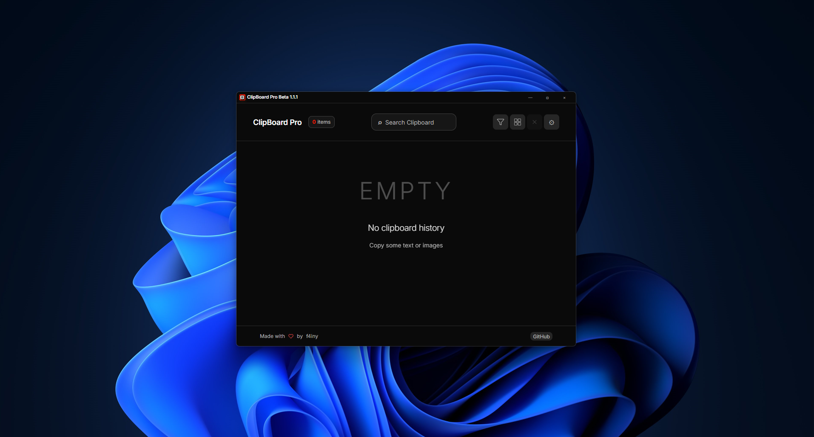
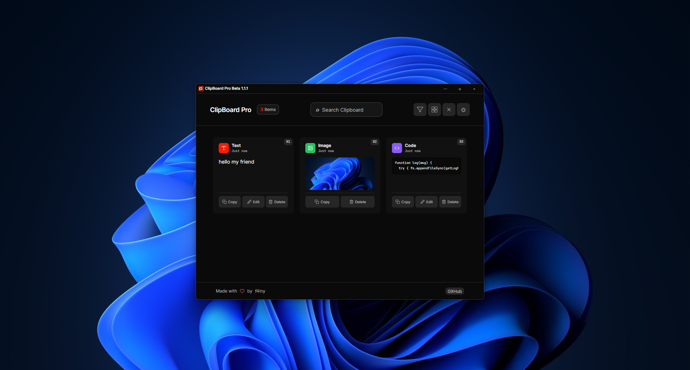
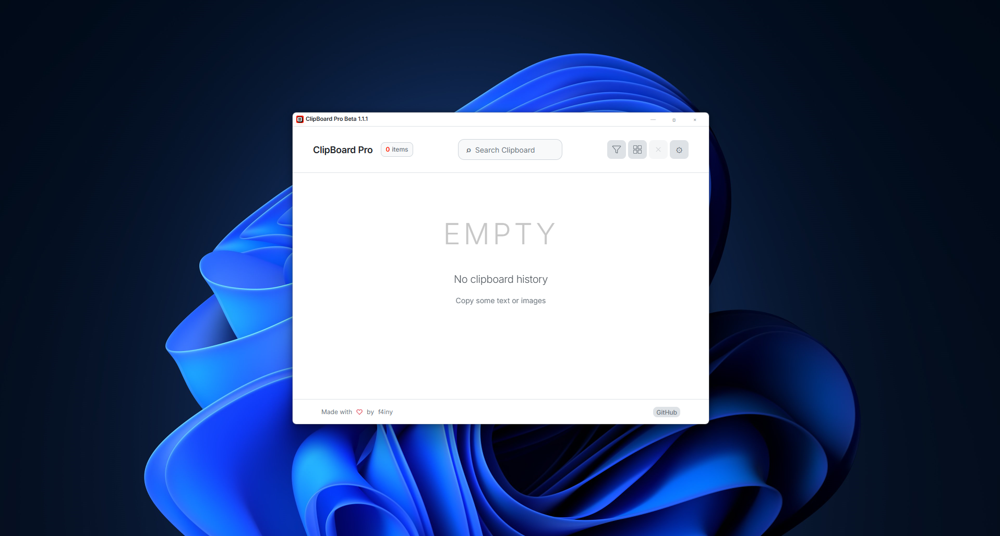
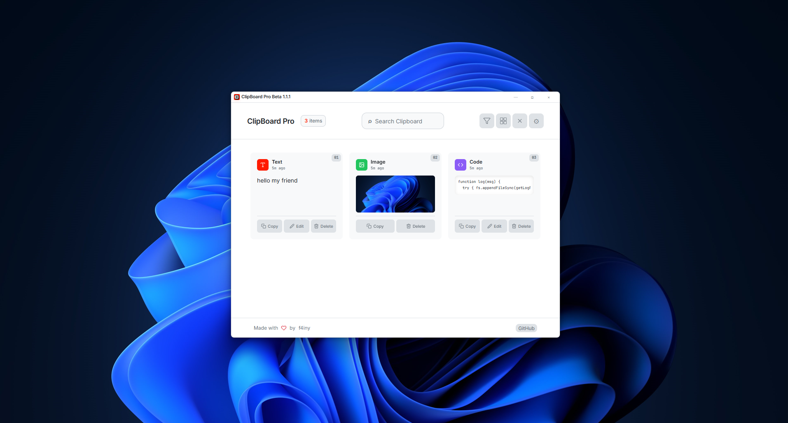
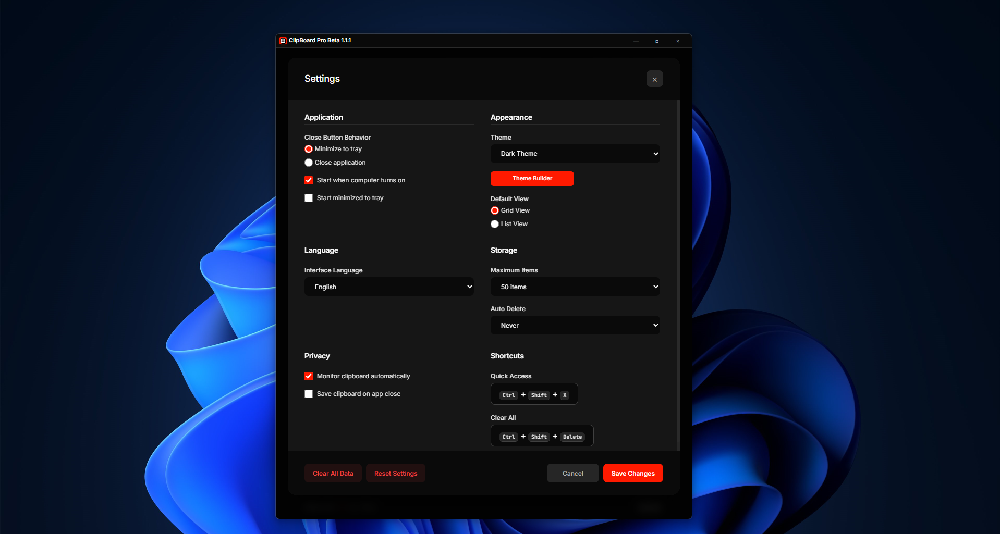

# ClipBoard Pro

A high-performance, lightweight clipboard manager desktop utility for Windows, macOS, and Linux built with Electron and React. It sits quietly in your system tray, watches your clipboard, and maintains a searchable history of everything you copy — text, code snippets, and images.

**Version:** Beta 1.0.0  
**Repository:** [github.com/f4iny/ClipBoardPro](https://github.com/f4iny/ClipBoardPro)  
**License:** GNU General Public License v3.0

---

## Preview







---

## Why ClipBoard Pro?

Every developer copies and pastes dozens of snippets, paths, commands, and screenshots every day. Most of it vanishes the moment something new is copied. ClipBoard Pro solves this:

- **Local & Private:** No cloud accounts, no telemetry, no tracking. Your clipboard data never leaves your machine.
- **Ultra-Low Memory Footprint:** Background idle memory drops to under 26 MB in the system tray via Win32 working set trimming.
- **Zero CPU Polling:** Event-driven Windows message hooks (`WM_CLIPBOARDUPDATE`) with 50 ms debouncing eliminate CPU wakeups.
- **Disk-Backed Media Storage:** High-resolution screenshots are stored as PNG files on disk rather than bloating memory or exceeding browser quotas.

---

## Features

- **Event-Driven Clipboard Monitoring** — Instantaneous capture of text, code, and image entries with debounced burst protection.
- **Smart Content Detection** — Automatically categorizes copied entries into Text, Code, or Images.
- **Fast Search & Filter** — Instant substring search across entries and quick filtering by type with dynamic counters.
- **Grid and List Views** — Toggle between a visual card grid and a compact list layout with keyboard accessibility.
- **Inline Editor** — Edit text and code entries directly in the app before re-copying or reusing.
- **Visual Theme Builder** — Customize backgrounds, borders, accents, and button states with live preview, import, and export.
- **Multi-Language Support (i18n)** — Available in 9 languages (English, Russian, Thai, Japanese, Korean, Chinese, Spanish, French, German).
- **System Tray & Auto-Start** — Runs minimized to tray on startup, configurable global hotkeys, and minimize-on-close behavior.
- **Automatic History Pruning** — Configurable auto-delete intervals (5 minutes to 30 days) and FIFO 50-item cache limits.

---

## Tech Stack

| Layer | Technology | Description |
|---|---|---|
| **Runtime** | Electron 37 | ES Module main process with isolated context bridge |
| **Renderer UI** | React 18 | Functional components with hooks and context |
| **Bundler** | Vite 5 | Rapid compilation and hot module reloading |
| **Styling** | SCSS | CSS custom properties, GPU-accelerated compositing |
| **Icons** | `react-icons` | Feather & Ionicons glyph sets |
| **Testing** | Vitest 2 & Happy-DOM | Comprehensive unit, utility, and state tests |
| **Native Helpers** | C# / .NET (`trim_memory.exe`) | Win32 `psapi.dll` `EmptyWorkingSet` memory trimmer |
| **Packaging** | Electron Builder | Multi-platform packaging targeting `release/` |

---

## Architectural Decisions & Documentation

ClipBoard Pro is engineered according to formal Architecture Decision Records:

- **[ADR-0001: Working Set Trimming on Idle](./docs/adr/0001-working-set-trimming-on-idle.md)** — Trims unmapped renderer and GPU memory 2 seconds after minimizing to tray.
- **[ADR-0002: Media Storage Lifecycle & Reconciliation](./docs/adr/0002-media-storage-lifecycle-and-cleanup.md)** — Disk-backed PNG storage in `%APPDATA%\ClipBoardPro\media` prevents `QuotaExceededError` and V8 heap bloat.
- **[ADR-0003: Event-Driven Clipboard Monitoring](./docs/adr/0003-event-driven-clipboard-monitoring.md)** — Event hooks replace continuous interval polling, protecting C-states and CPU thermals.
- **[ADR-0004: Native Chromium Content Visibility](./docs/adr/0004-native-chromium-content-visibility.md)** — CSS `content-visibility: auto` off-screen rendering for smooth 240 Hz scrolling without virtualization artifacts.
- **[BUGS Registry](./BUGS.md)** — Documented root causes and resolutions for all identified issues.
- **[Decisions & Rationale](./DECISIONS.md)** — Engineering choices and evaluated alternatives.
- **[Gotchas & Traps](./GOTCHAS.md)** — Platform quirks, task runner hooks, and packaging lessons.

---

## Getting Started

### Prerequisites

- **Node.js** 18 or later (tested on Node 20 & 24)
- **npm** or **pnpm**

### Installation

```bash
git clone https://github.com/f4iny/ClipBoardPro.git
cd ClipBoardPro
npm install
```

### Development

Run the Vite development server:
```bash
npm run dev
```

Build native helpers and start Electron:
```bash
npm run electron
```

### Running Tests & Linting

```bash
# Run all Vitest test suites
npm test

# Run Vitest in watch mode
npm run test:watch

# Run ESLint checks
npm run lint
```

### Production Build

```bash
# Compile native memory helper and bundle React frontend
npm run build

# Package Windows installer (.exe via NSIS)
npm run dist:win

# Package for current platform
npm run dist
```

Installers and executables are output to the `release/` directory.

---

## Project Structure

```
ClipBoardPro/
├── src/
│   ├── components/         # React UI components (Header, Item, Settings, ThemeBuilder)
│   ├── electron/           # Main process, preload bridge, debouncers
│   ├── utils/              # i18n localization, ThemeManager, helpers
│   ├── scss/               # Component-level modular SCSS
│   ├── App.jsx             # Main application orchestrator
│   └── main.jsx            # React root entry point
├── test/
│   ├── electron/           # Unit tests for clipboard debouncer, media storage, memory trim
│   ├── utils/              # Unit tests for ThemeManager and i18n
│   └── components/         # Unit tests for filtering, search, and category counts
├── resources/              # Native C# source and compiled helper binaries
├── docs/                   # Architecture documentation and ADRs (0001-0004)
├── scripts/                # Native build scripts (build-native.mjs)
├── public/                 # Static application assets and logos
├── BUGS.md                 # Registry of verified bug resolutions
├── DECISIONS.md            # Technical decisions and rationale
├── GOTCHAS.md              # Platform and packaging pitfalls
└── package.json            # Scripts, dependencies, and Electron-Builder configuration
```

---

## Keyboard Shortcuts

| Shortcut | Description | Default |
|---|---|---|
| **Quick Access** | Bring ClipBoard Pro to focus at cursor position | `Ctrl+Shift+X` |
| **Clear All** | Wipe clipboard history immediately | `Ctrl+Shift+Delete` |
| **Escape** | Close open modals or settings | `Esc` |
| **Ctrl+Enter** | Save inline entry edit | `Ctrl+Enter` |

---

## Contributing

Contributions are welcome! Please follow these standards:

1. **Test Coverage:** Include automated tests in `test/` for any new logic or bugfixes.
2. **Lint Cleanliness:** Ensure `npm run lint` passes with 0 errors and 0 warnings.
3. **Build Integrity:** Ensure `npm run build` and `npm test` execute cleanly before submitting PRs.

---

## License

GNU GENERAL PUBLIC LICENSE  
Version 3, 29 June 2007  

Copyright (c) 2026 ClipBoard Pro ([f4iny](https://github.com/f4iny/ClipBoardPro))
